<!-- ⌨️ 打字机效果标语 -->

**Java 后端工程师 · Spring Boot · 1 年经验**

🔗 [hoshiikunn.cn](https://hoshiikunn.cn)

---

## 🛠️ 技术栈

### 语言

### 后端 & 中间件

### 💻 常用系统

### 🧰 开发工具

### 🤖 AI 工作流

> 日常用 GLM-5.3 + Codex 做 AI 结对编程：问代码怎么写、查类与 API 的用法、做方案规划与技术调研；前端页面喜欢直接让 AI 生成。

---

## 🚀 里程碑 Roadmap

> 🎯 计划完成的项目 · 已完成 **0 / 4** · 随进度持续更新

| # | 项目 | 说明 | 状态 |
|:-:|:-----|:-----|:----:|
| 01 | **🛒 EzShop 简易商店** | 后台管理系统 + 前台系统，从 0 到 1 的完整电商项目 |  |
| 02 | **⚙️ 自研后台管理系统** | 通用后台管理脚手架，沉淀可复用技术组件 |  |
| 03 | **🌐 重构个人网站** | hoshiikunn.cn 全站重构与体验升级 |  |
| 04 | **⛏️ Minecraft 插件** | Java 版服务器插件开发 |  |

---

## 📊 GitHub 统计

  
  
  

---

## 📬 联系我

